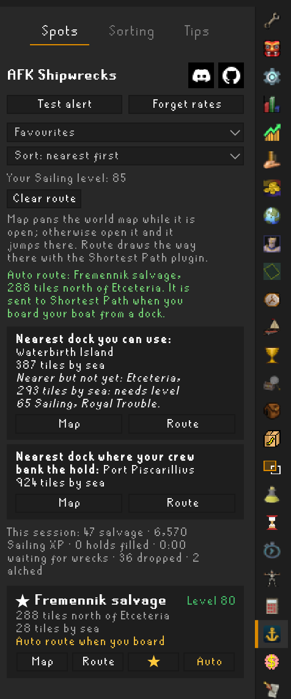
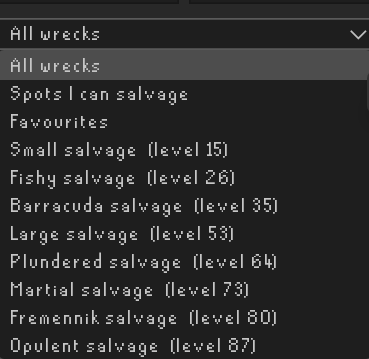
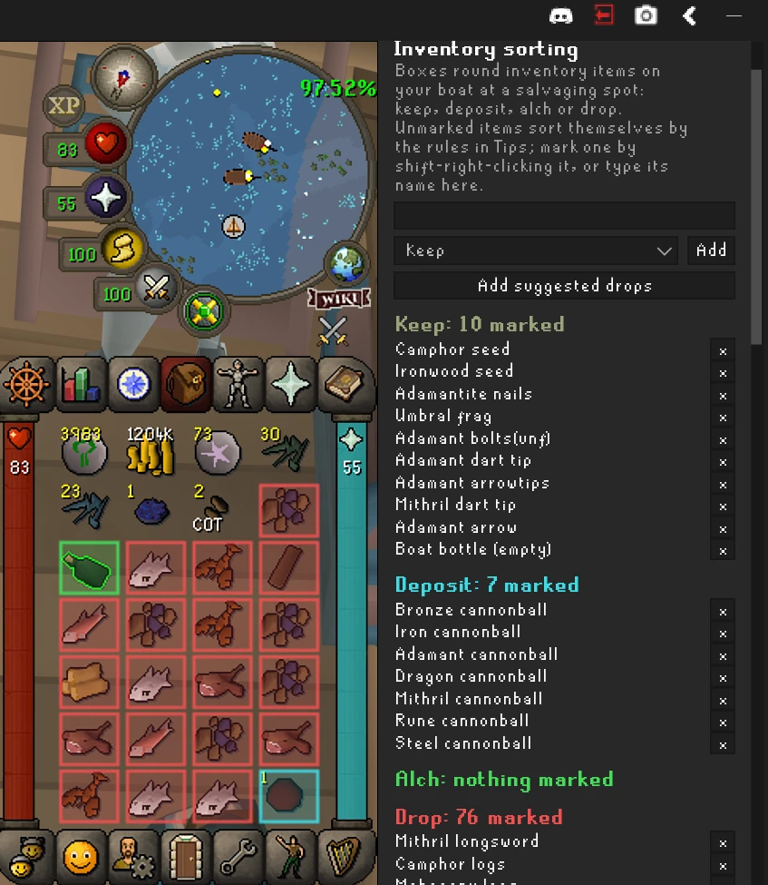

# AFK Shipwrecks

An all-in-one plugin for salvaging, whether you're fully AFK or working the hooks yourself. Park at
a shipwreck, put your crew on the hooks, and it tells you how long until the cargo hold is full,
then tells you loudly when it is. Along the way it shows where to park, which hook has gone empty,
what to do with your inventory and where to click next on deck.

> **[See everything it does in the Gallery](https://github.com/Brettgod1355/AFK-Shipwrecks/wiki/Gallery)**: every feature in short videos and looping
> animations, each with a line on what it shows.

It started life as Cargo Hold Alert, and everything that plugin did is still here.

New to it? [Getting started](https://github.com/Brettgod1355/AFK-Shipwrecks/wiki/Getting-started) walks you
through a first trip, and the [wiki](https://github.com/Brettgod1355/AFK-Shipwrecks/wiki) covers every feature
and setting.

**At a glance**

- Timers for a full hold, each wreck sinking, the next wreck rising and the game's idle logout,
  built from the wiki's figures and tuned by what your crew actually bring in.
- A full-hold alert with a banner and an early warning, and repeats that wait while you sail to
  the bank.
- Reminders when a hook goes empty, your own hook stops, the crew stop, or a better crewmate is
  sitting idle.
- Boxes on the water showing where a hook reaches a wreck, and where it reaches two at once.
- Inventory boxes for Keep, Deposit, Alch and Drop, and your next step on deck lit up: the
  station, the hold or a hook.
- A sidebar with every salvaging spot, the nearest docks, and routes through Shortest Path.
- A nudge toward the salvaging worlds when you've waited too long for a wreck.

It never clicks anything for you and sends nothing anywhere.

## See it in action

Video not playing? [Watch it on GitHub](https://github.com/Brettgod1355/AFK-Shipwrecks#see-it-in-action).

https://github.com/user-attachments/assets/03b0cbbf-cc82-4cd3-b50c-d2d91e217555

The hold alerts: the orange nearly-full banner and a screen flash as the count reaches 200/210, then
the overlay counting down the last seconds to the red full-hold banner and its flash. Both can play a
sound too, your own if you like: set it in the plugin's Full hold settings.

Video not playing? [Watch it on GitHub](https://github.com/Brettgod1355/AFK-Shipwrecks#see-it-in-action).

https://github.com/user-attachments/assets/7671fd8a-857b-42a7-afff-937fae6f9cc2

Parking: the reach boxes round each wreck and the green double spot, the label counting your hooks in
until it says Parked, then the big boxes clear away and the wreck timers stay.

Video not playing? [Watch it on GitHub](https://github.com/Brettgod1355/AFK-Shipwrecks#see-it-in-action).

https://github.com/user-attachments/assets/f28564c5-f5e7-459b-935b-484b2665534a

Your next step lights up on deck: the drop and alch boxes, then the cargo hold for the deposit, the
salvaging station once you've taken salvage out, and, with too little salvage left in the hold to fill
your inventory, a hook.

More, including marking items and where to click for an empty hook, in the **[Gallery](https://github.com/Brettgod1355/AFK-Shipwrecks/wiki/Gallery)**.

The sidebar: every salvaging spot with its distance by sea, the nearest docks, and routes through
the Shortest Path plugin.

Inventory sorting: items get a box for deposit, alch or drop, and the Sorting tab lists what you
have marked. Keep has a box too, off by default; switch on "Box kept items" in the Inventory sorting
settings to see it. Without any marks, anything that high-alchs for 1,000 gp or more gets the alch
box by itself; change that amount with "Alch from" in the same settings. Marking an item Alch
yourself boxes it whatever its alch value, so the threshold only decides for items you have not
marked.

## What it does

The [wiki](https://github.com/Brettgod1355/AFK-Shipwrecks/wiki) explains every feature and setting in detail.

- **[Timers](https://github.com/Brettgod1355/AFK-Shipwrecks/wiki/Timers).** "Hold full in about 52 min",
  built from the game's published salvage chances and corrected by what your crew bring in. Every wreck in
  view shows how long it has left, a sunk one when the next can rise, and the overlay says when the next
  wreck can come up at your spot and warns before the idle logout.
- **[Alerts and reminders](https://github.com/Brettgod1355/AFK-Shipwrecks/wiki/Alerts-and-reminders).** A
  full-hold notification and banner, an early warning at 5 slots left, and reminders when a hook is empty,
  your own hook stops, the crew stop, a better crewmate is idle, or the boat is in danger.
- **[Parking and double spots](https://github.com/Brettgod1355/AFK-Shipwrecks/wiki/Parking-and-double-spots).**
  Yellow boxes where a hook can reach each wreck, green ones where it reaches two, and "Parked" once every
  hook is in.
- **[Sorting and your next step](https://github.com/Brettgod1355/AFK-Shipwrecks/wiki/Sorting-and-your-next-step).**
  Deposit, Alch, Drop and Keep boxes on your inventory, marked with shift-right-click, and an outline on the
  station, hold or hook you should go to next.
- **[The sidebar panel](https://github.com/Brettgod1355/AFK-Shipwrecks/wiki/The-sidebar-panel).** All 29
  salvaging spots with their distance by sea, the nearest docks, routes through Shortest Path, a session line,
  and Find a setting.

## Good to know

- The game only shows the hold's contents while it's open. In between, the plugin keeps count; opening the
  hold resyncs it.
- Wreck timers are upper limits: a wreck's clock starts when anyone first salvages it, which your client
  can't see.
- It never clicks anything for you. Fully AFK still means touching the client before the idle logout; it
  warns you a minute before.
- No web requests other than RuneLite's own world list, no accounts, nothing sent anywhere. Shortest Path is
  optional, only used for routes.

The full list is in [How it works and its limits](https://github.com/Brettgod1355/AFK-Shipwrecks/wiki/How-it-works-and-its-limits).

## Install

Search for **AFK Shipwrecks** in the RuneLite Plugin Hub. New to it? See
[Getting started](https://github.com/Brettgod1355/AFK-Shipwrecks/wiki/Getting-started).

For development: clone the repo and use `./gradlew run` for a development client or
`./gradlew test` for the tests. In IntelliJ, run `AfkSalvagingPluginTest`.

## Found a bug? Want something?

Open an issue on GitHub: <https://github.com/Brettgod1355/AFK-Shipwrecks/issues>. If you'd rather,
ask a question, make a suggestion or report a bug on Discord instead:
<https://discord.gg/c85DK83jWx>. Both are one click away from the sidebar's Feedback tab. What's coming
next is on the [Plans](https://github.com/Brettgod1355/AFK-Shipwrecks/wiki/Plans) page.

## License

BSD 2-Clause. See [LICENSE](LICENSE) and
[THIRD_PARTY_NOTICES.md](THIRD_PARTY_NOTICES.md). Not affiliated with Jagex or
RuneLite.
